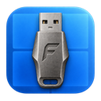
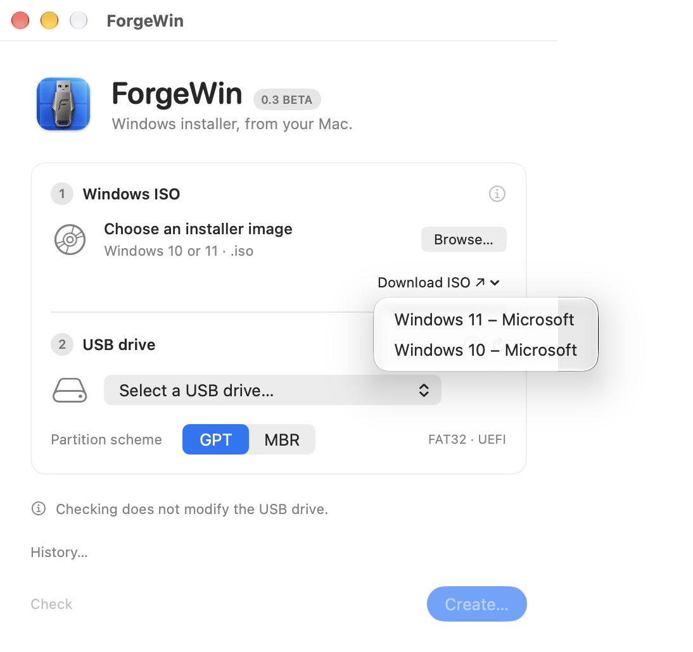
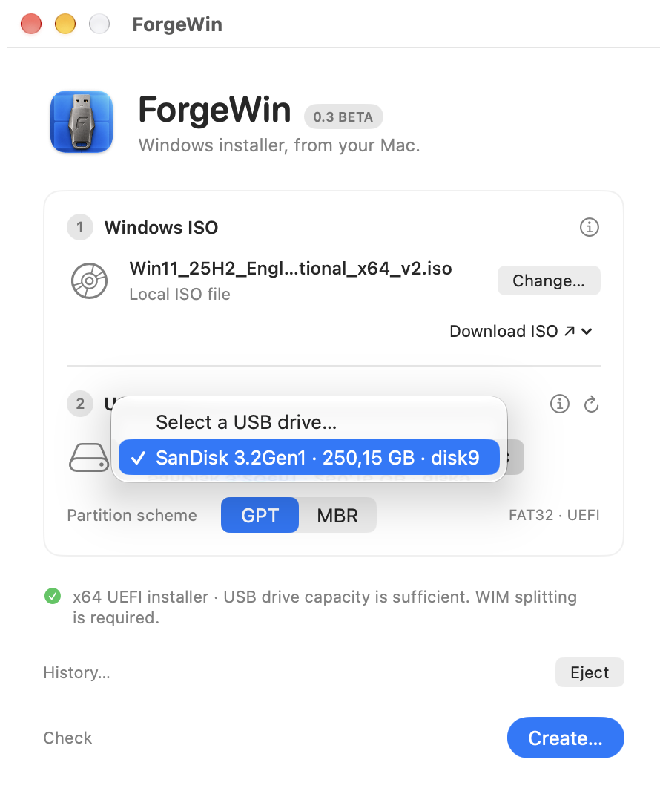
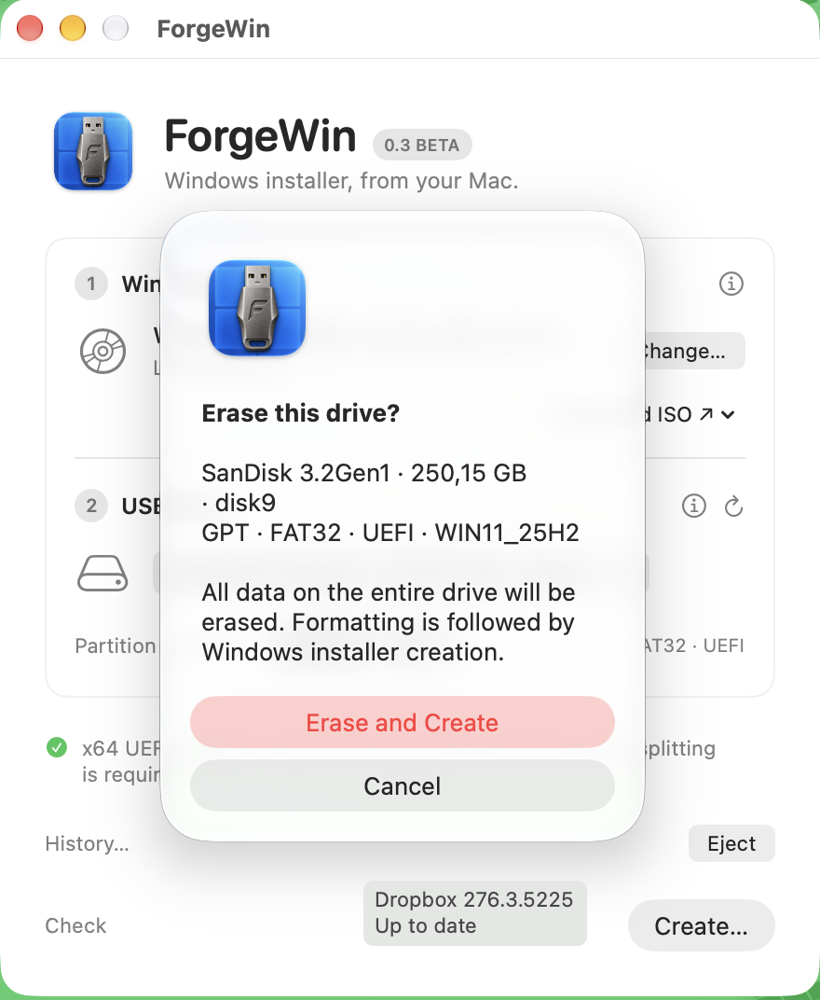
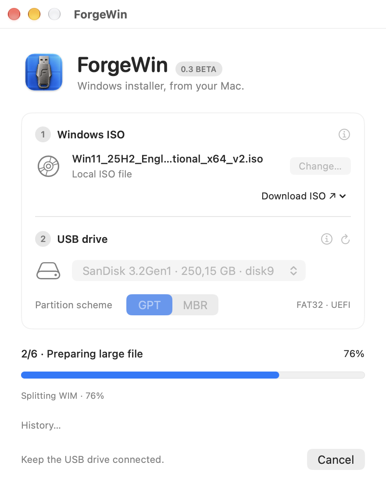
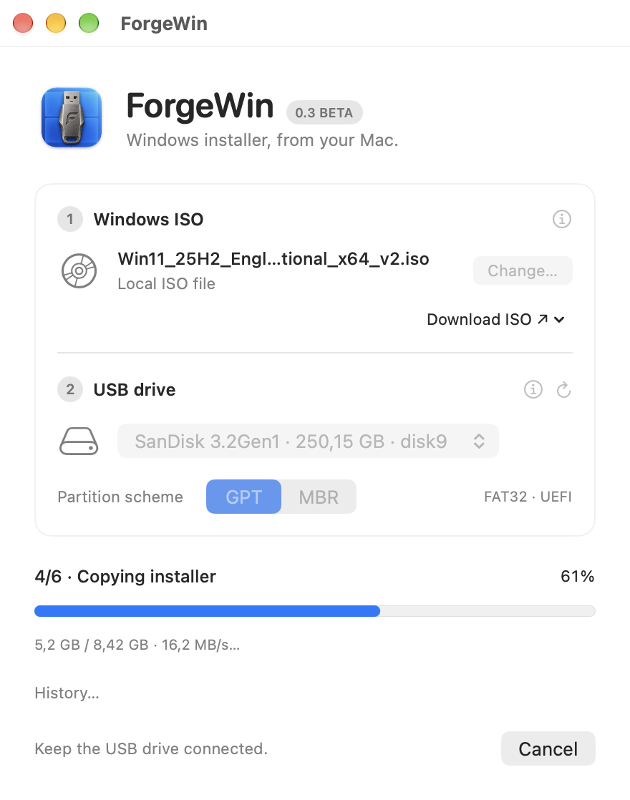
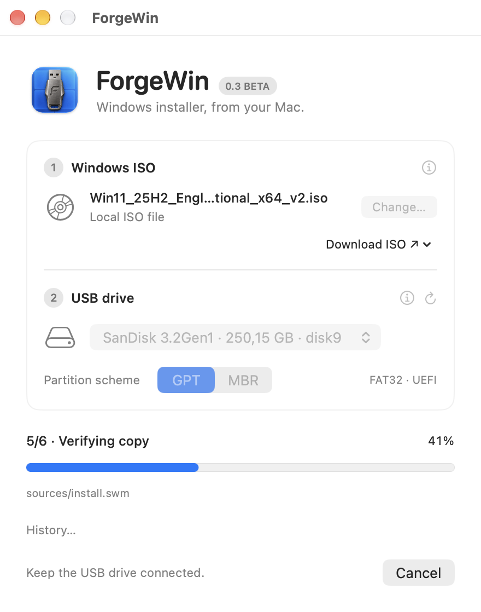
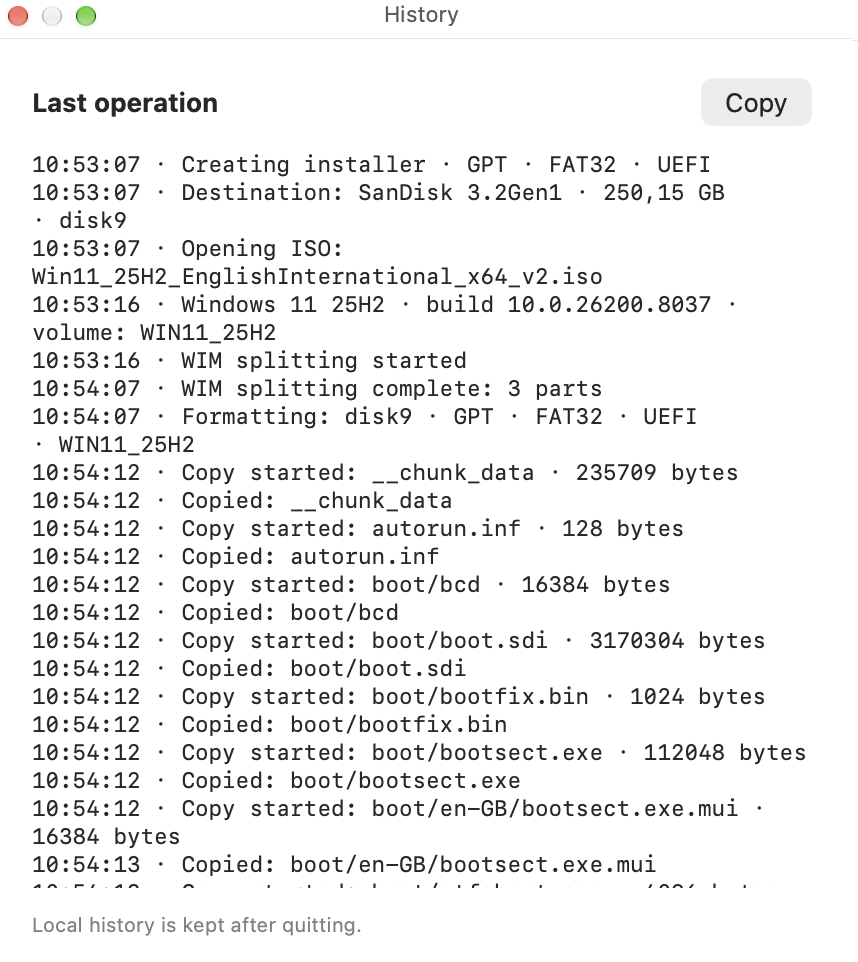

# ForgeWin for Mac

Create a Windows 10 or Windows 11 USB installer on your Mac. ForgeWin is a native macOS app with English and Hungarian interfaces.

**Beta software. Creating an installer erases every partition and all data on the selected USB drive.** Back up anything you need before proceeding.

[Download from Releases](https://github.com/macrobi/ForgeWin/releases) · [Magyar útmutató](README.hu.md)

## Screenshots

Click a screenshot to view it at full size.

| | |
| --- | --- |
| **Download a Windows ISO**  | **Select the USB drive**  |
| **Confirm drive erasure**  | **Split a large Windows image**  |
| **Copy the installer**  | **Verify the copied files**  |
| **View operation history**  |  |

## Requirements

- macOS 14 or later. The app includes Apple Silicon and Intel binaries.
- An official Windows 10 or Windows 11 **x64** ISO, obtained separately from Microsoft.
- An external physical USB drive, no larger than 2 TB, with enough capacity for the installer.
- Free space on your Mac for temporary files when a large Windows image needs splitting.

Installers target **x64 UEFI PCs**. Legacy BIOS and ARM Windows are not supported. ForgeWin does not install Windows on the Mac running it.

## Install and use

1. Open [Releases](https://github.com/macrobi/ForgeWin/releases), choose the beta release, and download its `.dmg` asset. The automatically generated “Source code” archives contain this documentation, not the app.
2. Open the disk image and drag **ForgeWin** to **Applications**. Launch it from there.
3. Select your Windows ISO and the USB drive. Review the drive information carefully.
4. Confirm the target and start creation. Keep the drive connected until ForgeWin reports that it is safe to remove.

ForgeWin prepares FAT32 media with GPT by default; MBR is also available for UEFI use. It automatically splits large `install.wim` files, copies the installer, and reads the copied files back for SHA-256 comparison. A matching copy does not prove that a particular PC will boot it.

The app includes its WIM tool. No Homebrew installation or account is required. Its built-in Help is available offline.

## Current beta

Version **0.3 beta, build 6**. Real PC UEFI/Secure Boot startup and Windows installation, physical Intel execution, and macOS 14 execution still require validation for this release. See the [release notes](docs/RELEASE_NOTES.md) and [usage notes](docs/USAGE.md).

## Feedback and privacy

Report reproducible problems through [Issues](https://github.com/macrobi/ForgeWin/issues). Include the app version, macOS version, Mac type, USB model and the exact error. Remove personal paths and filenames from screenshots or logs before posting.

ForgeWin processes the ISO and USB locally. It has no analytics, tracking or automatic log upload. Recent operation history and the last error are stored locally. Microsoft download links open your browser. See [Privacy](docs/PRIVACY.md).

## Copyright and third party software

Copyright Veress Róbert 2026. This repository contains distribution documentation; ForgeWin's own source code is private. See [Copyright](COPYRIGHT.txt).

The bundled `wimlib-imagex` has its own GPL-3.0-or-later license. Its license texts, original source and rebuild script are included in the app. See [Third party notices](THIRD_PARTY_NOTICES.md).

ForgeWin is not a Microsoft product. No Windows ISO or Windows license is included.
